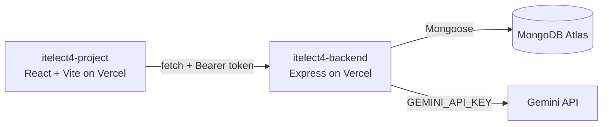

# ITElect4 Lost & Found Frontend

React 19, Vite, TypeScript, TailwindCSS v4, shadcn/ui, Zustand, and TanStack Query frontend for the GT6 Lost & Found application.

- **Live Frontend:** https://itelect4-project-psi.vercel.app
- **Backend repo:** https://github.com/Chylle-prog/itelect4-backend

## Architecture

## Live deployment

- Frontend: https://itelect4-project-psi.vercel.app

## Run locally

1. Install dependencies with `npm install`.
2. Copy `.env.example` to `.env`. Leave `VITE_API_URL` empty to use the Vite development proxy, or set it to the backend origin (e.g. `http://localhost:4000`).
3. Start the backend from the sibling `../itelect4-backend` folder.
4. Run `npm run dev` and open the Vite URL it prints.

Run `npm run build` to type-check and create the production frontend build.

## Pages

| Route | Access | Description |
| --- | --- | --- |
| `/login` | Public | Email/password login |
| `/register` | Public | New account registration |
| `/` | Protected | Dashboard |
| `/users` | Protected | User list |
| `/items` | Protected | Lost & found item list |
| `/items/:id` | Protected | Item detail (owner only for edits/delete) |
| `/claims` | Protected | Claims list (claimant or item owner) |
| `/review` | Protected | AI Review page (Session 11) |

Navigating to `/review` while logged out redirects to `/login` � the route sits inside the same `ProtectedRoute` guard as `/submissions` and every other private page.

## AI Review page (`/review`)

Added in Session 11. Provides a form where a logged-in user pastes a description of their lost-and-found report. On submit, the form calls `askAi()` in `src/api/client.ts`, which `POST`s to `/api/ai` with the user's Bearer token. The backend sends the text to Gemini and returns a structured review. The page renders every field of the reply:

| Field | Shown as |
| --- | --- |
| `summary` | Short paragraph |
| `strengths` | Bulleted list |
| `improvements` | Bulleted list |
| `readiness` | Badge (`ready` / `almost` / `not-yet`) |

The Gemini API key is never sent to this frontend. The browser only calls `/api/ai` on the backend; the backend calls Gemini. You can confirm this in DevTools > Network: filter for `googleapis` � nothing appears.

## Environment variables

| Variable | Notes |
| --- | --- |
| `VITE_API_URL` | Backend origin. Leave empty in development to use the Vite proxy. Set the deployed backend URL for the Vercel project. |

Do not commit `.env`.

## AI-Use Disclosure

AI assistants were utilized during development for code syntax verification, lockfile debugging, and structuring test suites. All application features, schema design, and integrations were reviewed and tested by the author in adherence to course guidelines.
